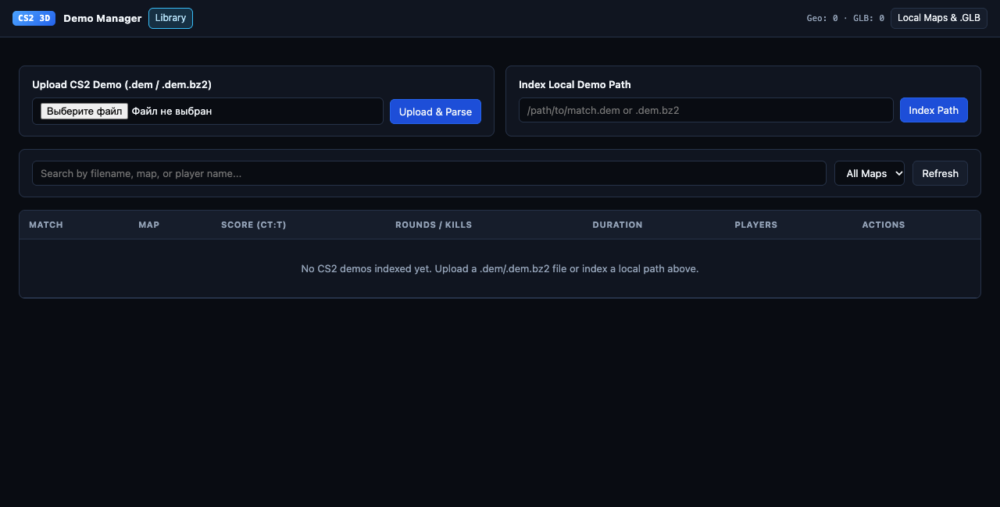

# CS2 3D Demo Manager

A standalone web app for indexing Counter-Strike 2 match demos and watching them in an interactive 3D replay viewer. A Go server parses demos and stores the library in SQLite. Three.js renders the match in the browser.



## What you can do

- Upload a `.dem` or `.dem.bz2`, or index a file already on the server without copying it. Search and filter the library by map, filename, or player.
- Watch a round from a player's point of view, fly around the map, or switch to the tactical overhead camera.
- Step through individual ticks, change playback speed, and bookmark moments. Review scores, kills, grenades, bomb events, and player inventories in the replay HUD.
- Add your own local map and visual assets for textured environments, radar images, operators, weapons, and animations. No demos or game assets are bundled.

## Build and run

You'll need Go 1.25 or newer, Node.js 22 or newer, npm, and a browser with WebGL 2. Enable hardware graphics acceleration in the browser for 3D playback.

```sh
npm --prefix web ci
npm --prefix web run build
go run ./cmd/server
```

Open [http://127.0.0.1:4175](http://127.0.0.1:4175). The server binds to loopback by default and has no authentication. Keep it on your own machine or a trusted private network; don't expose it to the internet.

| Flag | Environment variable | Default |
| --- | --- | --- |
| `-addr` | `CS2_ADDR` | `127.0.0.1:4175` |
| `-data` | `CS2_DATA_DIR` | `./data` |
| `-geo-dirs` | `CS2_GEO_DIRS` | `./assets/geo` |
| `-asset-dirs` | `CS2_ASSET_DIRS` | `./assets/maps` |
| `-static` | `CS2_STATIC_DIR` | `./web/dist` |

The directory flags accept comma-separated paths. Pass `-geo-dirs /path/to/geometry` for local `geo_<map>.bin` or `geo_<map>.bin.gz` files in CSGEO1 format. These provide fallback 3D geometry and can align imported maps.

## Replay controls

| Key | Action |
| --- | --- |
| `T` | Tactical orbit camera |
| `F` | Free camera. Use WASD, Space/E, C/Q, and Shift to move; drag to look. |
| `1`–`9`, `0` | Switch to player slots 1–10 |
| `X` | Toggle X-ray and player nameplates |
| `F3` | Toggle renderer diagnostics: GPU, FPS, frame time, draw calls, and triangles |
| `Tab` | Toggle the scoreboard |
| `Space` | Play or pause outside free camera |
| `←` / `→` | Step one tick outside free camera |

## Optional local game assets

Use your own CS2 installation or [DepotDownloader](https://github.com/SteamRE/DepotDownloader) with an account entitled to the relevant Steam depot. Open the VPKs with [Source 2 Viewer (ValveResourceFormat / VRF)](https://github.com/ValveResourceFormat/ValveResourceFormat) and export maps and models as GLB. Keep material textures with their export, or embed them in the GLB. Rename the files to the names the viewer expects:

```text
data/assets/
  maps/de_nuke.glb
  players/ct_sas.glb
  players/t_phoenix.glb
  players/operator_anims.glb
  weapons/ak47.glb
  radars/de_nuke_radar.png
  radars/de_nuke_lower.png
  skyboxes/de_nuke.webp
```

Use `-asset-dirs /path/to/asset-root` to point the server at another directory with the same layout. Map GLBs can also be added from **Local Maps & .GLB** in the library. The animation bundle is optional and needs the Source 2 operator skeleton and the clip names used by the viewer; a generic animation export is not a drop-in replacement.

Valve's game assets are proprietary. Keep exports local and don't redistribute them or commit them to Git. Keep private demos, databases, and screenshots out of the repository as well.

## Test

```sh
go test ./...
npm --prefix web test
```

The browser integration suite additionally needs local Cache (`.dem.bz2`) and Nuke (`.dem`) fixtures, CSGEO1 files, and the corresponding maps, operators, animation bundle, weapons, radar, and skyboxes. Its combat and replay checks need fixtures with the gameplay events they exercise. Set the same fixture variables to enable the real-demo and map checks in `go test`.

```sh
npm --prefix web run build
npm --prefix web exec -- playwright install chromium
CS2_TEST_CACHE_DEMO=/path/to/cache.dem.bz2 \
CS2_TEST_NUKE_DEMO=/path/to/nuke.dem \
CS2_GEO_DIRS=/path/to/geometry \
CS2_ASSET_DIRS=/path/to/asset-root \
  node tests/e2e/e2e.test.mjs
```

Set `E2E_BROWSER_CHANNEL=chrome` to use an installed Chrome. Screenshots go to the ignored `data/test-renders/` directory unless `E2E_RENDERS_DIR` is set.
